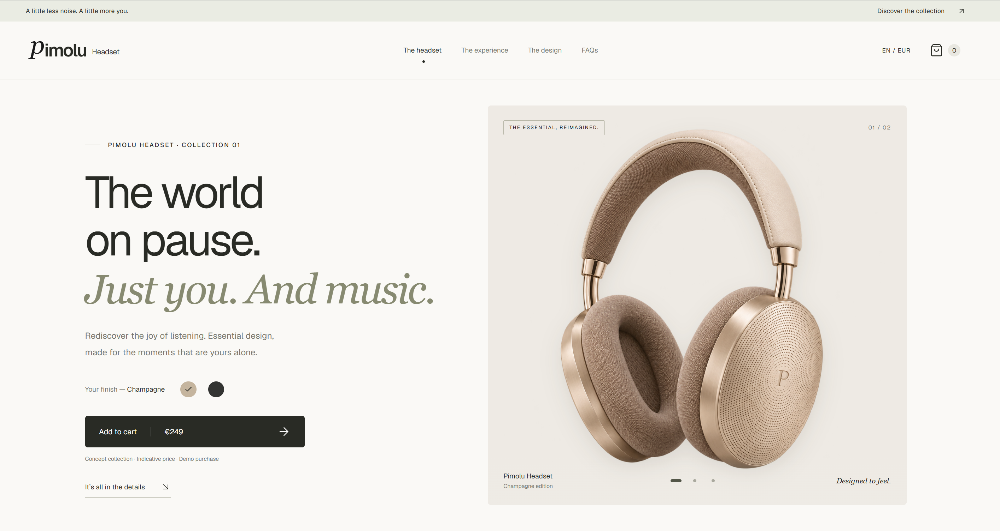

# Pimolu Headset



A product storefront showcase built with **[Pimolu UI](https://pimolu.com/)**.

Pimolu Headset demonstrates how Pimolu UI can bring a complete shopping experience to life: responsive layouts, product presentation, interactive controls, persistent cart state and accessible overlays, all within one visual system.

The project pairs a warm, minimal design with an English interface, Champagne and Graphite product finishes, and transparent product imagery. Use it to explore the library, learn from a working implementation or build your own showcase.

## What this showcase demonstrates

- **Product presentation:** finish selection, close-up views and a collection grid.
- **Shopping interactions:** a persistent cart, quantity controls, removal and an indicative order summary.
- **Responsive navigation:** desktop links and a mobile navigation drawer.
- **Content components:** design accordions, FAQs and a newsletter demo.
- **Motion and accessibility:** keyboard controls, labelled actions, focus management and reduced-motion support.
- **Visual customisation:** a shared Pimolu theme, application styles and Lucide icons.

This is a concept storefront. Prices and product details are illustrative. No real orders or payments are processed, and the newsletter form does not send or store email addresses.

## Built with Pimolu UI

Pimolu provides the interface components throughout the showcase:

| Area                          | Components used                         |
| ----------------------------- | --------------------------------------- |
| Layout                        | `Box`                                   |
| Typography                    | `Heading`, `Paragraph`, `Text`          |
| Actions and navigation        | `Button`, `Link`                        |
| Product media and details     | `Image`, `Badge`, `Separator`           |
| Forms                         | `Input`                                 |
| Expandable content            | `Accordion` and its compound components |
| Cart and mobile menu          | `Drawer` and its compound components    |
| Selection summary and privacy | `Dialog` and its compound components    |
| Theme                         | `PimoluProvider`                        |

Shared styles are loaded once in [`app/globals.css`](app/globals.css):

```css
@import "@pimolu/web-styles/layered.css";
```

The provider in [`app/storefront.tsx`](app/storefront.tsx) selects the light theme, monochrome preset, radius and brand colour. Application CSS customises the composition and component appearance. Lucide supplies the pictograms.

For buttons that only display an icon, use Pimolu’s `startIcon` prop and provide an accessible label:

```tsx
import { Button } from "@pimolu/react";
import { Plus } from "lucide-react";

<Button
  iconOnly
  startIcon={<Plus size={18} aria-hidden="true" />}
  aria-label="Add Champagne headset to cart"
/>;
```

The repository includes a **90% minimum Pimolu UI usage guard** for JSX in `app/storefront.tsx`. It compares Pimolu component nodes with native JSX nodes in that file. Decorative icons, local component calls and the Next.js document shell are outside this measurement. This is a source-level check, not a bundle-size or project-wide coverage metric.

## Tech stack

- Next.js 16 App Router
- React 19 and TypeScript
- `@pimolu/react` and `@pimolu/web-styles`
- `lucide-react`
- ESLint, Prettier and the Node.js test runner

The Pimolu packages are pinned to a beta release. Refer to [`package.json`](package.json) and [`package-lock.json`](package-lock.json) for the exact dependency versions.

## Getting started

Use **Node.js 22 or newer** and npm. The project has been validated with Node.js 24.

Clone this repository, open its directory, then run:

```sh
npm ci
npm run dev
```

Open [http://localhost:3000](http://localhost:3000). The storefront is served in English at `/`; `/en` redirects to `/`. Prices are displayed in euros using the `en-GB` number format.

### Environment configuration

No API keys or external services are required to run the showcase locally.

For deployment, copy [`.env.example`](.env.example) to `.env.local` and set the base URL used by the page metadata and social sharing:

```dotenv
NEXT_PUBLIC_SITE_URL=https://your-domain.example
```

The default is `http://localhost:3000`.

### Production

```sh
npm run build
npm run start
```

## Development commands

| Command                | Purpose                                                         |
| ---------------------- | --------------------------------------------------------------- |
| `npm run dev`          | Start the development server with Fast Refresh                  |
| `npm run build`        | Create the production build                                     |
| `npm run start`        | Serve the production build                                      |
| `npm run format`       | Format project files with Prettier                              |
| `npm run format:check` | Check formatting without changing files                         |
| `npm run lint`         | Run ESLint with no warnings allowed                             |
| `npm run lint:fix`     | Apply automatic ESLint fixes                                    |
| `npm run typecheck`    | Generate Next.js route types and check TypeScript               |
| `npm run check:ui`     | Check the storefront’s Pimolu UI usage threshold                |
| `npm test`             | Run the cart entrance lifecycle tests                           |
| `npm run check`        | Run formatting checks, lint, TypeScript, the UI guard and tests |

Before submitting a change, run:

```sh
npm run check
npm run build
```

Follow [`AGENTS.md`](AGENTS.md) for repository-specific Next.js guidance.

## Project structure

```text
app/
  page.tsx              # Storefront route
  layout.tsx            # Document language, fonts, metadata and icons
  storefront.tsx        # Page composition, product data and interactions
  globals.css           # Pimolu styles, custom design and responsive rules
  use-cart.ts           # Persistent cart store and React subscription
  cart-entrance.tsx     # Drawer entrance lifecycle integration
  cart-motion.ts        # Entrance scheduling and focus coordination
public/
  images/               # Product cutouts, cart thumbnails and lifestyle image
  pimolu-icon.svg       # Pimolu brand symbol
scripts/
  check-pimolu.mjs      # Storefront JSX usage guard
tests/
  cart-motion.test.mjs  # Opening, cancellation and reduced-motion tests
```

## Customising the showcase

| What you want to change                              | Where to start                                   |
| ---------------------------------------------------- | ------------------------------------------------ |
| Product names, finishes, images and indicative price | `finishes` and `price` in `app/storefront.tsx`   |
| Branding, page copy, FAQs and demo messages          | `app/storefront.tsx`                             |
| Pimolu theme, preset and brand colour                | `PimoluProvider` in `app/storefront.tsx`         |
| Layout, typography, spacing and responsive behaviour | `app/globals.css`                                |
| Page title, descriptions, language and social image  | `app/layout.tsx`                                 |
| Cart persistence and quantity validation             | `app/use-cart.ts`                                |
| Drawer entrance timing and focus behaviour           | `app/cart-entrance.tsx` and `app/cart-motion.ts` |

Product images use transparent WebP files so the cutouts blend into the page surfaces. The cart uses dedicated 220 × 220 thumbnails. When replacing assets, update the product image paths and the social image metadata as needed.

The cart is stored locally under `pimolu-headset-cart`. It supports both finishes, quantities from 1 to 9 per finish, removal and synchronisation between tabs on the same origin. If browser storage is unavailable, the current selection remains available in memory.

To turn the showcase into a real shop, connect a server-side catalogue and order flow, a payment provider and a newsletter service. Replace the illustrative product information and demo messages with verified content and actual sales terms.

## Resources

- [Pimolu UI](https://pimolu.com/)
- [Pimolu component catalogue](https://pimolu.com/components)
- [Pimolu source code](https://github.com/pimoludev/ui)

## License

[MIT](LICENSE) — © 2026 pimoludev.
